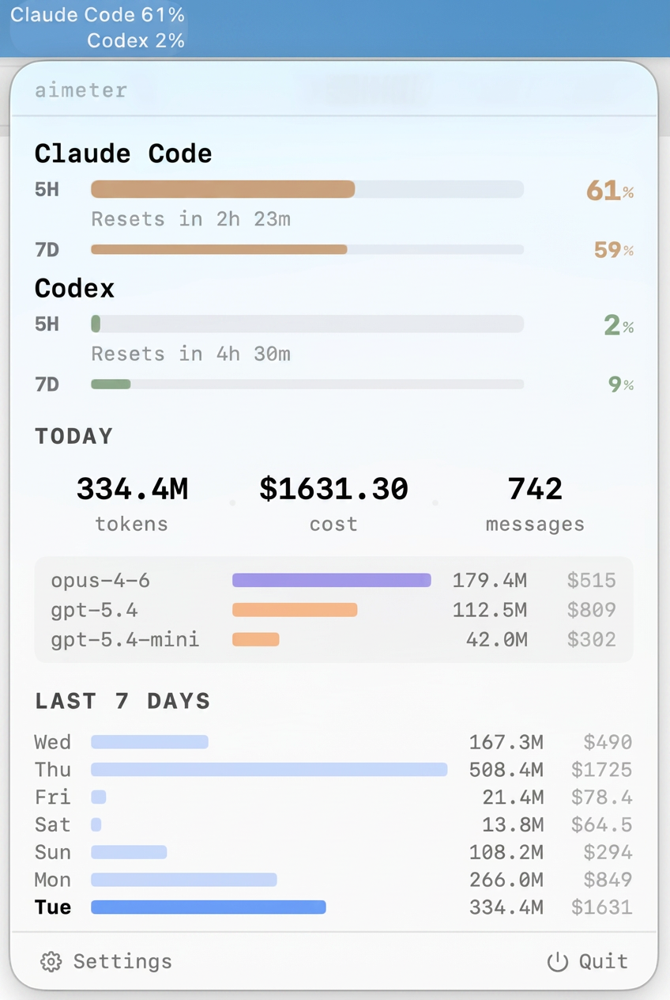

# aimeter

[](LICENSE)
[](https://github.com/wangyufeng0615/aimeter/releases)
[](https://github.com/wangyufeng0615/aimeter/commits)

[中文 README](README_CN.md)

Keep an eye on your Claude and Antigravity quotas and local [Claude Code](https://code.claude.com/) / [Codex CLI](https://github.com/openai/codex) / [Antigravity](https://antigravity.google/) / Gemini CLI token spend right from the macOS menu bar—no accounts, no cloud sync, everything parsed locally.

> I use this every day myself and plan to maintain it for the long haul.

<p align="center">
  
</p>

## What it shows

- **Claude quota at a glance**: 5-hour and weekly subscription limits, pulled from your latest local Claude Code or Claude Desktop snapshot (Desktop snapshots expire after 30 minutes).
- **Antigravity Gemini quota**: used share and reset time, in the panel and the menu bar, read from the running Antigravity language server on 127.0.0.1; the last snapshot stays after it quits until its reset time passes.
- **Token usage & cost**: daily breakdown from local Claude Code, Codex CLI, Antigravity (IDE and CLI, Gemini models only) and Gemini CLI logs (Claude Desktop chat is not included). Antigravity's Gemini codenames have no public price, so their cost shows as unknown.
- **Zero log upload**: all parsing runs on your Mac; no prompts, sessions, or usage history ever leave the device.

## Install

```bash
brew tap wangyufeng0615/aimeter && brew install --cask aimeter
```

Or download the zip directly from [Releases](https://github.com/wangyufeng0615/aimeter/releases).

Updates are built in via Sparkle (checks once a day and asks before installing). You can also check manually in **Settings → Updates**, or run `brew upgrade --cask aimeter`.

> On first launch, aimeter asks to add a statusline hook for Claude Code so it can read rate limits. Codex, Antigravity and Gemini CLI work out of the box with no setup.

## Privacy

All log parsing stays on your Mac and no usage data is uploaded. aimeter makes only two kinds of outbound requests: fetching model pricing from [LiteLLM](https://github.com/BerriAI/litellm), and checking the Sparkle appcast on GitHub (plus downloading the signed release zip if you approve an update). There is no analytics or telemetry. See [SECURITY.md](SECURITY.md) for the exact file paths and network endpoints.

## Development

Build and contribution guide: [CONTRIBUTING.md](CONTRIBUTING.md).

## License

[MIT](LICENSE). Model pricing from [LiteLLM](https://github.com/BerriAI/litellm); cost calculation inspired by [ccusage](https://github.com/ryoppippi/ccusage).
