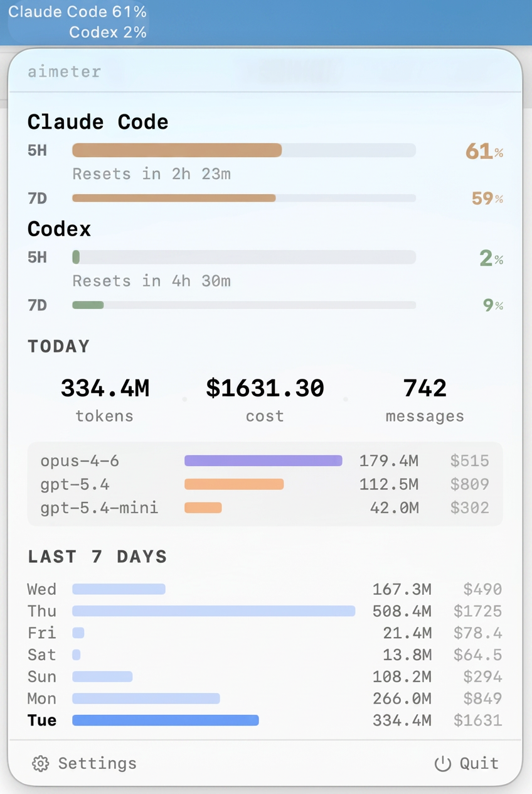

# aimeter

[](LICENSE)
[](https://github.com/wangyufeng0615/aimeter/releases)
[](https://github.com/wangyufeng0615/aimeter/commits)

[English README](README.md)

一个轻量的 macOS 菜单栏工具：抬头就能看到 Claude 与 Antigravity 的剩余额度，以及本地 [Claude Code](https://code.claude.com/)、[Codex CLI](https://github.com/openai/codex)、[Antigravity](https://antigravity.google/) 和 Gemini CLI 的 token 用量与估算费用。所有记录都在本机解析，不上传云端。

> 我自己每天都在用，会长期认真维护。

<p align="center">
  
</p>

## 主要功能

- **一眼看清 Claude 额度**：读取本机最新的 Claude Code 或 Claude 桌面版快照，展示 5 小时 / 每周限额（桌面版快照超过 30 分钟自动过期）。
- **Antigravity 额度**：Antigravity 运行时向本机（127.0.0.1）语言服务读取各模型池（Gemini、Claude/GPT）的已用比例与重置时间，关闭后保留最近一次快照。
- **Token 用量与费用**：解析本地 Claude Code、Codex CLI、Antigravity（IDE 与 CLI）和 Gemini CLI 记录，按模型统计用量和花费（不含 Claude 桌面版聊天）。Antigravity 的 Gemini 代号模型没有公开单价，费用显示为未知。
- **纯本地、不上传**：日志解析全在本机完成，你的对话、记录和用量不会发往任何外部服务器。

## 安装

```bash
brew tap wangyufeng0615/aimeter && brew install --cask aimeter
```

也可以直接去 [Releases](https://github.com/wangyufeng0615/aimeter/releases) 下载 zip。

内置 Sparkle 自动检查更新（每天检查一次，由你确认后安装）；也可以在 **设置 → 更新** 里手动检查，或运行 `brew upgrade --cask aimeter`。

> 首次启动会请求给 Claude Code 加一个 statusline hook 用于读取限额；Codex、Antigravity 与 Gemini CLI 开箱即用，无需配置。

## 隐私

所有日志解析都在本机完成，不会上传任何 CLI 使用记录。应用仅会发起两类外部请求：从 [LiteLLM](https://github.com/BerriAI/litellm) 拉取模型单价，以及从 GitHub 检查 Sparkle 更新 feed（你同意升级后才下载已签名的安装包）。没有任何统计或遥测。完整读写路径与网络端点见 [SECURITY.md](SECURITY.md)。

## 开发

构建与参与开发说明见 [CONTRIBUTING.md](CONTRIBUTING.md)。

## License

[MIT](LICENSE)。模型定价来自 [LiteLLM](https://github.com/BerriAI/litellm)；费用计算思路参考了 [ccusage](https://github.com/ryoppippi/ccusage)。
